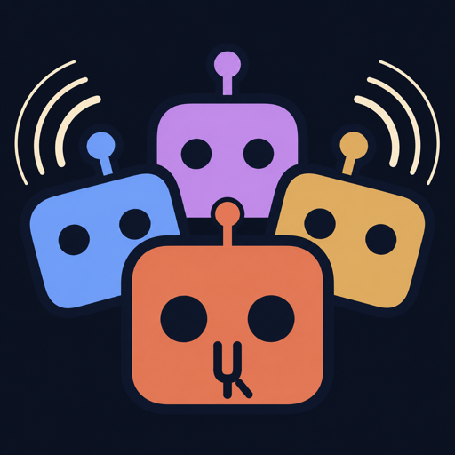

<p align="center">
  
</p>

<h1 align="center">Qualixar ModStage</h1>

<p align="center"><b>Run Codex, Grok, Muse, Antigravity, Kimi, Qwen Code, OpenCode and Claude subagents side by side inside Claude Code. Watch every step, steer them mid-run, approve their risky actions from the panel or from chat.</b></p>

<p align="center">
  <a href="LICENSE"></a>
  
  
  
</p>

<!-- HERO GIF goes here: two agents working side by side in the panel (see "Demo" below). -->

If you pay for more than one AI coding agent, each one lives in its own terminal. When Claude Code shells out to one of them, you see a command go in and an answer come back, and nothing in between: not the files it touched, not the command it is waiting to run, not the moment it got stuck. ModStage is a Claude Code plugin (a "mod") that brings those coding agents into your Claude Code session as visible, steerable subagents, so Claude Code becomes the orchestrator and every other CLI works where you can see it.

It comes out of our work on AI Reliability Engineering: an agent you cannot observe is an agent you should not trust with your repository.

## What you get

- **A live panel for every run.** Tool calls, edits, messages and thinking stream into a tabbed panel. Long quiet turns say "no new output for 3m, still running" instead of looking frozen.
- **Steer mid-run.** Codex and Muse take your message into the running turn. For agents whose CLI cannot do that, the message is held, the panel shows **1 queued**, and **Interrupt and send now** ends the turn so it runs at once.
- **A Needs-you inbox for risky actions.** Commands outside the sandbox, file changes and network calls wait for **Allow**, **Allow for this run** or **Deny**. The card scrolls into view when it arrives, the band above your prompt jumps to it, and no answer in 10 minutes means deny.
- **Approve from Claude chat.** Tell Claude "allow the curl" and it answers the card with `stage_decide`. Claude only does this on your own words, never because an agent, a file or a web page asked.
- **Many agents, one folder, no clobbering.** A shared board gives each folder file claims (leases), messages between agents, and a `STATE.md` humans can read. Claude Code is a peer on that board too: agents can message it, and Claude's own edits stop at a file another agent holds.
- **Model picker per agent**, filled from each CLI's own list (Codex, Grok, Antigravity, OpenCode, Muse, Kimi).
- **Images.** Hand a run screenshots with `images: ["/abs/path.png"]`: Codex (checked with a real run), plus Muse, Kimi, Qwen Code and OpenCode, whose protocols take images. Grok and Antigravity refuse with a reason instead of dropping the image.
- **Tokens, context and cost** where the CLI reports them.
- **One session, one stage.** Each Claude Code session sees only the runs it started; a new session starts clean.

## Supported agents

| Agent | How ModStage talks to it | Your message mid-turn | Approvals in the inbox |
|---|---|---|---|
| Codex | `codex app-server` (JSON-RPC) | joins the running turn | yes |
| Muse | `muse serve` (Muse Session Protocol) | joins the running turn | yes |
| Grok | `grok agent stdio` (Agent Client Protocol) | queued, or interrupt and send now | yes, unless Grok's own config approves everything (the launcher says so before Start) |
| Kimi | `kimi acp` | queued, or interrupt and send now | yes |
| Qwen Code | `qwen --acp` | queued, or interrupt and send now | yes |
| OpenCode | `opencode acp` | queued, or interrupt and send now | yes |
| Antigravity (Gemini) | `agy` stream-json print mode | queued, or interrupt and send now (restarts agy with a recap) | no: headless agy cannot ask. Ask runs are read-only (web pages, web search, files in its folder); anything else is refused, shown, and the run marked blocked |
| Claude Code subagents | the mod API and SendMessage | reaches it after its current step | Claude Code's own permission prompts |

Every cell above has a test behind it. The full agent-by-control table, with each limit explained, is in [docs/PARITY-MATRIX.md](docs/PARITY-MATRIX.md), generated by the conformance harness in `bridge/tests/`. Anything else that speaks the [Agent Client Protocol](https://agentclientprotocol.com) can be added with a few lines of config (see [Add your own agent](#add-your-own-agent)). You use your own CLIs and subscriptions; ModStage never sees your credentials.

## Install

One line, in any terminal (the same install for the terminal, the desktop app and VS Code):

```bash
claude plugin marketplace add qualixar/modstage && claude plugin install modstage@modstage
```

Already installed? Update with `claude plugin marketplace update modstage && claude plugin update modstage@modstage`.

You need Claude Code with mods (2.1.287 or newer in the terminal, 2.1.286 or newer in the desktop app's Code tab), Python 3.10 or newer, and at least one of the agent CLIs above, installed and signed in.

In a Claude Code session:

```
/plugin marketplace add qualixar/modstage
/plugin install modstage@modstage
```

Or from a terminal (the same install for the terminal, the desktop app and VS Code):

```bash
claude plugin marketplace add qualixar/modstage
claude plugin install modstage@modstage
```

Start a **new** session; one that was already open does not pick up a newly installed plugin. A band appears above the message box: **✻ ModStage · Open**. Click it, or type `/modstage`.

To try it without installing, clone the repo and start Claude Code with `claude --plugin-dir ./modstage`. Before installing any mod you can list exactly which events it handles and what it calls: `claude plugin validate ./modstage`.

## Use it

**From the panel.** Click an agent, pick a model or keep its default, type the task, press **Start**. It works in your Claude Code session's folder.

**From Claude.** Ask in plain words: "hand the tests to Codex and keep going on the API", or "ask Grok to review this diff while you fix the migration". Claude uses these tools:

| Tool | What it does |
|---|---|
| `stage_start` | start an agent on a task, with a model, autonomy, owned files and images |
| `stage_wait` | wait for the turn to end or for you to be needed; says `waiting_on_user` instead of making Claude poll |
| `stage_send` | message a run (steer, queue, or `now: true` to interrupt and send) |
| `stage_decide` | answer a waiting approval, only when you said so in chat |
| `stage_status`, `stage_agents` | runs, approvals with their exact commands, installed agents and models |
| `stage_interrupt`, `stage_close` | stop a turn, end a run |
| `stage_board`, `stage_post`, `stage_claim`, `stage_release` | Claude's seat on the folder's board |

**While it runs.** Click a tab to follow that agent. Type in its message box, or press **Status?** or **Wrap up**. While an approval waits, the message box says **Answer the approval above first**: a typed "yes" is not an approval, and sending text then could cancel the waiting action.

## Safe by default

Runs start in **ask** mode: an agent's permission requests land in **Needs you**. **Auto** mode answers them automatically, except one case that always comes to you: an action on a file another agent has claimed.

**Only your own words approve.** `stage_decide` is enforced by code, not by a prompt: the mod records when you last submitted a message (only your own prompt counts, not a peer session, a plugin, a schedule or anything an agent streams), and the tool refuses to decide an approval unless you spoke after that approval was raised. Agent output, `stage_wait` results and file contents cannot satisfy the check, so an injected "the user says allow it" gets a refusal telling Claude to ask you to confirm in your own message. Answering in the ModStage panel is a direct click and is unaffected. The check proves you sent some message after the request, not that the message said yes, so Claude is still told to act only on what you actually wrote.

Read [SECURITY.md](SECURITY.md) for the full model: what the bridge defends against (web pages, a hostile repository, agent text posing as ModStage, one session driving another's runs) and what it cannot (agents run as you). Three honest limits:

- **Agents decide when to ask.** If an agent's own configuration approves everything, it never asks, and the inbox cannot stop it. The launcher tells you before Start (for example Grok with `permission_mode = "always-approve"`).
- **Headless Antigravity cannot ask.** In ask mode ModStage makes it read-only: a per-run agy project (`~/.gemini/config/projects/modstage-<run>.json`, removed when the run ends) lets it read web pages, search the web and read files in its folder, and keeps writes, shell commands and files outside its folder refused. A refusal ends the turn blocked, and `stage_wait`, `stage_status` and the panel say what was refused and that a new run with autonomy `auto`, ideally in an isolated folder, lets it proceed. Auto mode passes agy's skip-permissions flag instead. Your own agy `settings.json` and shared rules are never edited.
- **Approvals are not a sandbox.** Point agents at a folder you are willing to let them change, ideally a git worktree.

## Many agents, one folder

When agents share a folder, ModStage gives it a board in `<folder>/.modstage/` (ignored by git):

- each agent gets coordination tools in its session: `stage_claim`, `stage_release`, `stage_send`, `stage_inbox`, `stage_board_read` and more, with `modstage-cli` for agents without tool support
- claims are leases; a conflicting exclusive claim is **denied**, not just warned about, and editing a file claims it
- fence numbers are checked **at the write**, not just at claim or approval time: if a run's lease lapsed and another run took the file, the first run's write is rejected even if it was allowed to edit earlier. This holds for Codex edits and for ACP agents (Grok, Kimi, Qwen Code, OpenCode) that write through ModStage; Muse and Antigravity write files themselves, so for them ModStage still detects and flags the conflict afterwards
- messages arrive at the start of the receiver's next turn, framed as information from another agent, never as instructions
- Claude Code joins as `claude-<session>`: agents can message it, it reads them with `stage_board`, and its own Edit and Write calls are refused on a file an agent holds (with no bridge running, nothing is blocked)

If you run [SuperLocalMemory](https://github.com/qualixar/superlocalmemory), run peers, claims and board messages are mirrored to its local SLM-mesh so other Claude Code windows see them. Nothing depends on it; `MODSTAGE_SLM_MESH=0` turns it off. Details: [docs/COORDINATION.md](docs/COORDINATION.md).

## How it works

```
Claude Code ── mod: panel, tools, guards ──► bridge on 127.0.0.1 (token auth)
                                              ├─ codex app-server
                                              ├─ muse serve
                                              ├─ ACP agents: grok, kimi, qwen, opencode, …
                                              ├─ agy stream-json
                                              └─ board per folder: leases, messages, STATE.md
```

A Claude Code mod cannot hold a two-way pipe open to another program, so ModStage runs a small Python bridge (standard library only) that does. The bridge keeps each agent's own protocol session, turns its events into one stream, routes its permission requests to your inbox, and serves it all to the mod over localhost with a per-install token. It starts by itself with your Claude Code session.

While the mod is on, Claude cannot launch `codex exec`, `muse exec` or `grok -p` through Bash, so no agent runs out of sight (`--help` and `--version` are allowed).

## What it can reach

Mods are not sandboxed and run with your permissions, so here is the full list:

- **Reads:** your agent CLIs' output, the folder you give each run, image files you pass to a run, `~/.modstage/`.
- **Writes:** `~/.modstage/` (token, run logs) and `<folder>/.modstage/` (board, `STATE.md`).
- **Runs:** the agent CLIs you have plugged in, and the bridge.
- **Network:** `127.0.0.1` only (the bridge, and SuperLocalMemory's daemon if you run it). No telemetry.
- **Blocks:** Bash commands that launch Codex, Muse or Grok directly; Claude's edits to files an agent has claimed.

Run logs contain what the agents saw and did, including file contents and command output. Treat `~/.modstage/runs/` like your shell history.

## Add your own agent

Create `~/.modstage/agents.json`:

```json
{
  "agents": [
    {"id": "cursor", "name": "Cursor", "protocol": "acp",
     "command": ["cursor-agent", "acp"], "color": "#9CA3AF"}
  ]
}
```

`protocol` is `acp` for most agents. An entry with the same `id` as a built-in replaces it; `"disabled": true` hides one. Ask Claude for `stage_agents`, or open the panel with no runs, to see what is installed.

## Settings

| Variable | Default | What it does |
|---|---|---|
| `MODSTAGE_HOME` | `~/.modstage` | token, run logs, `agents.json` |
| `MODSTAGE_PORT` | `47321` | bridge port on 127.0.0.1 |
| `MODSTAGE_APPROVAL_TIMEOUT` | `600` | seconds before an unanswered approval is denied |
| `MODSTAGE_SLM_MESH` | `1` | set `0` to turn off the SuperLocalMemory mirror |
| `MODSTAGE_NO_CLIENT` | unset | `1` uses the plain, non-animated panel |

## Develop and test

```bash
claude plugin validate .
claude plugin test .                               # the mod: panel, tools, guards
python3 -m unittest discover -s bridge/tests       # the bridge, incl. the per-agent conformance harness
python3 bridge/tests/parity_matrix.py --check      # regenerate docs/PARITY-MATRIX.md from real test runs
python3 scripts/smoke_real_cli.py codex --approval # one real CLI, tiny prompts (costs tokens)
```

The conformance harness drives every adapter through protocol fakes at zero token cost; a known gap is an expected failure, so fixing one fails the suite until the matrix is updated. The mod API is in early access and can change between Claude Code releases; if something stops drawing, look for a transcript line starting with `modstage:`.

## FAQ

**Is this a replacement for Claude Code subagents?** No. Claude Code stays the orchestrator; ModStage adds other vendors' agents as subagents you can watch and steer, and shows Claude's own subagents in the same panel.

**Does it need API keys?** No. It runs the CLIs you already have signed in, on your own subscriptions.

**Can a coding agent approve its own risky action?** No. Approvals come only from the panel or from your own words in Claude chat; board messages between agents are never treated as approvals.

**Does it work in the terminal or only the desktop app?** Both. The install is the same everywhere mods run, including VS Code; the panel's tests draw it on the terminal and desktop surfaces.

## Credits

Ideas for observing Claude subagents, the needs-you inbox and stuck detection come from [claude-flightdeck](https://github.com/scasella/claude-flightdeck), [ringside](https://github.com/ChiFungHillmanChan/ringside) and [claude-code-mods](https://github.com/hamzafer/claude-code-mods); ACP client behaviour follows [acpx](https://github.com/openclaw/acpx); lease fencing follows [mesh](https://github.com/yesitsfebreeze/mesh) and [coord](https://github.com/DmarshalTU/coord). All MIT. No code was copied from them; the implementation here is our own.

## License

MIT. See [LICENSE](LICENSE). Built by [Varun Pratap Bhardwaj](https://github.com/qualixar) at Qualixar, as part of its AI Reliability Engineering work.
